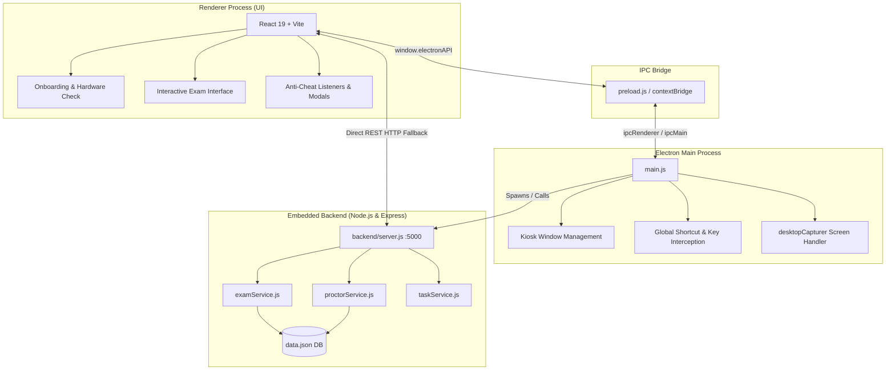

# Desktop Athena 🛡️
> A secure, locked-down desktop examination and automated proctoring application built with **Electron**, **React**, and an embedded **Express** backend.

---

## 📌 Overview

**Desktop Athena** is an integrity-focused desktop examination platform engineered to prevent academic dishonesty and administer secure computer-based tests. It transforms a standard desktop environment into a locked-down proctoring workstation featuring multi-layered anti-cheating mechanisms, automated candidate surveillance, real-time environment checks, and an automated grading engine.

The application combines native OS-level window constraints, WebRTC biometric hardware verification, periodic screen capture, clipboard suppression, and a dual-channel communication architecture (Electron IPC + REST API).

---

## ✨ Key Features

### 1. Pre-Exam System Readiness Check (Onboarding Gate)
Candidates cannot enter or view the exam until all three mandatory hardware and system checks are verified:
- **Webcam Verification**: Live mirrored camera preview, device enumeration, and on-demand proctor snapshot test.
- **Microphone & Acoustic Integrity**: Real-time microphone capture with an interactive dynamic Web Audio frequency visualizer and decibel meter.
- **Kiosk / Fullscreen Display Lock**: Fullscreen lockdown verification ensuring the application occupies the entire display without window chrome.

### 2. Multi-Layered Anti-Cheating & Integrity Guardrails
- **OS Kiosk & Window Lockdown**: Frameless window (`titleBarStyle: "hidden"`), hidden traffic lights/window controls, disabled min/max/close buttons, and removed application menus.
- **Escape Key Suppression**: The `Escape` key is intercepted and neutralized at both the OS level and renderer DOM. Attempting to press `Esc` triggers a locked toast alert without exiting fullscreen.
- **Clipboard Restriction**: Intercepts and blocks Copy (`Ctrl/Cmd+C`), Paste (`Ctrl/Cmd+V`), and Cut (`Ctrl/Cmd+X`) in both the Electron main process (`before-input-event`) and the renderer. Displays warning toasts on unauthorized keypresses.
- **System Navigation Blocking**: Suppresses dangerous key chords including `Ctrl/Cmd+M` (minimize), `Ctrl/Cmd+H` (hide), `Ctrl/Cmd+W` (close), and `Alt+F4`.
- **Focus Loss & Tab-Switch Detection**: Monitors `window.onblur` and `document.visibilitychange`. Any loss of focus or backgrounding triggers an immediate security violation alert modal and logs the event to the audit ledger.
- **Auto-Refocus & Kiosk Recovery**: If a user attempts to minimize or blur the window, the app immediately restores fullscreen kiosk mode and refocuses.
- **Emergency Supervisor Override**: Authorized proctors can terminate an active session at any time using the supervisor shortcut (`CommandOrControl + Q`).

### 3. Automated Surveillance & Snapshot Archival
- **Periodic Screen Capture**: Captures the candidate's active display every 10 seconds via WebRTC `getDisplayMedia` / `ImageCapture` / HTML5 Canvas and archives images directly to disk (`screen_snapshots/`).
- **Biometric Candidate Snapshots**: On-demand and automated camera snapshots archived to `proctor_snapshots/` and registered with metadata in the backend database.
- **Picture-in-Picture Live Proctor Feed**: Shows a continuous live camera overlay with an active monitoring pulse badge during the assessment.

### 4. Examination Engine & Instant Evaluation
- **Categorized Question Bank**: Multiple-choice questions categorized by domain (e.g., *Data Structures*, *Networking*, *Desktop Architecture*) with customizable marks.
- **Question Palette**: Live sidebar status matrix displaying answered, unanswered, and marked-for-review questions with one-click jumping.
- **Session Countdown Timer**: 90-minute real-time exam timer with continuous synchronization.
- **Automated Grading Engine**: Submissions are automatically evaluated against the answer key, calculating raw scores, total marks, percentage, and a question-by-question breakdown.

### 5. Proctor System Monitor & Real-Time Audit Log
- **In-App Supervisor Modal**: Accessible directly from the exam header to inspect live backend health status, port binding, and database statistics.
- **Live Metrics**: Displays total questions, cumulative security violation counts, snapshot counts, and submission records.
- **Timestamped Audit Trail**: Comprehensive event stream capturing violations, snapshot events, and candidate submissions.

---

## 🏗️ Architecture & Tech Stack



| Layer | Technologies | Role |
|---|---|---|
| **Desktop Runtime** | Electron 33 | Native window lifecycle, kiosk enforcement, global shortcuts, desktopCapturer |
| **Frontend Framework** | React 19, Vite 8, Tailwind CSS v4 | High-performance user interface, responsive state machines, audio/video canvas pipelines |
| **API Backend** | Node.js, Express 5, CORS | Embedded REST API running on port 5000 with auto-port fallback |
| **Bridge** | Electron `contextBridge` + `ipcMain` | Secure, context-isolated IPC channels exposing `window.electronAPI` |
| **Persistence** | File-based JSON Database (`backend/data.json`) | Stores questions, candidate submissions, violation logs, and snapshot records |
| **Disk Storage** | `proctor_snapshots/`, `screen_snapshots/` | Local directory storage for captured webcam frames and desktop screenshots |

---

## 📁 Project Structure

```text
electron-starter-kit/
├── backend/                      # Embedded Express backend
│   ├── data.json                 # JSON database (questions, submissions, audit logs)
│   ├── db.js                     # Atomic database read/write helpers
│   ├── server.js                 # Express REST API endpoints & server bootstrap
│   └── services/
│       ├── examService.js        # Question retrieval, exam submission, and score grading
│       ├── proctorService.js     # Violation logging, snapshot metadata, and system stats
│       └── taskService.js        # Auxiliary task management service
├── main.js                       # Electron main process (kiosk, shortcuts, IPC, server launch)
├── preload.js                    # Secure contextBridge exposing window.electronAPI
├── package.json                  # Root project scripts and Electron dependencies
├── proctor_snapshots/            # Local directory for candidate webcam captures
├── screen_snapshots/             # Local directory for periodic screen captures
└── renderer/                     # Vite + React 19 front-end application
    ├── index.html                # Single-page application entry HTML
    ├── package.json              # Frontend dependencies (React 19, Tailwind CSS v4, Vite)
    ├── vite.config.js            # Vite configuration (port 5174, Tailwind plugin)
    └── src/
        ├── App.jsx               # Primary application component (Onboarding, Exam, Modals)
        ├── index.css             # Global styles and Tailwind v4 setup
        └── main.jsx              # React DOM mounting
```

---

## 🚀 Getting Started

### Prerequisites
- **Node.js**: v18.0.0 or higher
- **npm**: v9.0.0 or higher
- A working **Webcam** and **Microphone**

### Installation

1. **Clone the repository:**
   ```bash
   git clone https://github.com/JACOBIAN01/electron-starter-kit.git
   cd electron-starter-kit
   ```

2. **Install root dependencies (Electron, Concurrently, Express, CORS):**
   ```bash
   npm install
   ```

3. **Install renderer dependencies (React, Vite, Tailwind CSS):**
   ```bash
   cd renderer
   npm install
   cd ..
   ```

---

## 💻 Running the Application

### Option A: Standard Launch (Recommended)
Run the root start script to concurrently start the Vite dev server (port `5174`) and the Electron desktop client (which automatically initializes the Express backend on port `5000`):

```bash
npm start
```

### Option B: Running Individual Components

- **Run only the React Vite dev server:**
  ```bash
  npm run dev
  # Server will run at http://localhost:5174
  ```

- **Run only the Express backend standalone:**
  ```bash
  npm run backend
  # Server will run at http://localhost:5000
  ```

- **Build the React frontend for production:**
  ```bash
  npm run build
  # Outputs compiled bundle to renderer/dist/
  ```

---

## 🔌 API & IPC Reference

### Electron IPC Channels (`window.electronAPI`)

| Method | IPC Channel | Description |
|---|---|---|
| `getQuestions()` | `get-questions` | Retrieves the assessment question list from backend database |
| `submitExam(candidateName, selectedAnswers)` | `submit-exam` | Grades candidate answers, records submission, and returns score breakdown |
| `logViolation(reason, count, metadata)` | `log-violation` | Logs an academic integrity incident to the backend audit ledger |
| `getProctorStats()` | `get-proctor-stats` | Retrieves summary counters (violations, questions, snapshots, submissions) |
| `getProctorLogs()` | `get-proctor-logs` | Retrieves full audit log history and violation items |
| `setFullscreen(flag)` | `set-fullscreen` | Programmatically enters or exits native kiosk / fullscreen mode |
| `setKiosk(flag)` | `set-kiosk` | Toggles Electron native kiosk lockout mode |
| `saveProctorSnapshot(base64Data)` | `save-proctor-snapshot` | Writes webcam frame to disk (`proctor_snapshots/`) and logs metadata |
| `saveScreenSnapshot(base64Data)` | `save-screen-snapshot` | Writes screenshot to disk (`screen_snapshots/`) and updates gallery |
| `closeApp()` | `close-app` | Gracefully closes all windows and terminates the application |
| `onShowWarning(callback)` | `show-warning` | Event listener for security violation warnings sent by the main process |

### Express REST API Endpoints (`http://localhost:5000`)

| Method | Endpoint | Description |
|---|---|---|
| `GET` | `/api/health` | Backend status, uptime, and service health check |
| `GET` | `/api/questions` | List of exam questions (optionally filters out answer keys) |
| `POST` | `/api/exam/submit` | Submits candidate responses, calculates score, and stores record |
| `GET` | `/api/exam/submissions` | Retrieves all historical exam submissions |
| `POST` | `/api/proctor/violation` | Logs an unauthorized security violation event |
| `POST` | `/api/proctor/snapshot` | Registers captured snapshot file details |
| `GET` | `/api/proctor/logs` | Returns full proctoring audit trails and incident logs |
| `GET` | `/api/proctor/stats` | Aggregated dashboard metrics and last activity timestamp |

---

## 📝 Exam Lifecycle & User Workflow

1. **Step 1: System Readiness & Permissions**
   - The candidate opens the application in default windowed mode.
   - The candidate grants Camera and Microphone permissions and tests hardware.
   - The candidate enters Fullscreen mode, locking the display and disabling standard desktop exit keys.
2. **Step 2: Candidate Identification & Rules Acceptance**
   - The "Start Examination" button unlocks once all 3 checks pass.
   - The candidate reviews the academic honesty guidelines and confirms their candidate name.
3. **Step 3: Proctored Exam Execution**
   - Screen capture begins capturing active desktop frames every 10 seconds.
   - Copying, pasting, alt-tabbing, and window blurring are blocked and flagged.
   - Candidate responds to questions and navigates using the question matrix.
4. **Step 4: Submission & Score Summary**
   - Upon clicking "Submit Exam" (or timer expiration), the backend calculates the final score.
   - A modal displays total score, percentage, correct answer analysis, and proctoring audit confirmation.

---

## 🔒 Security Configuration & Shortcuts

- **Emergency Force-Quit**: Press `Cmd + Q` (macOS) or `Ctrl + Q` (Windows/Linux) to exit the proctored window if required by an exam administrator.
- **Port Customization**: By default, the backend runs on port `5000` (auto-increments if port is busy), and the Vite frontend runs on port `5174`. These can be modified in `main.js` and `renderer/vite.config.js`.
- **Question Bank Customization**: Edit `backend/data.json` to modify, add, or categorize exam questions.

---

## 📄 License

This project is licensed under the [ISC License](LICENSE).
